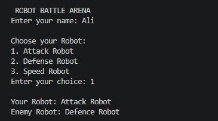
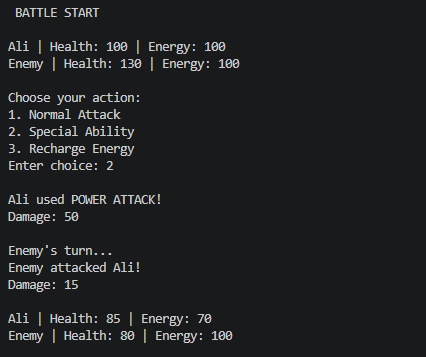
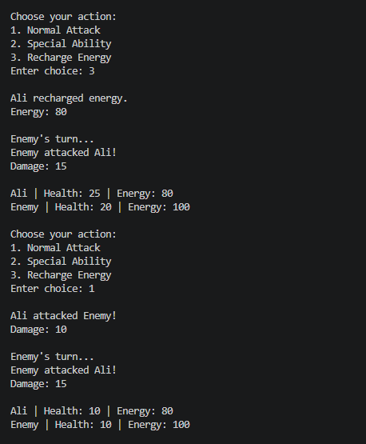
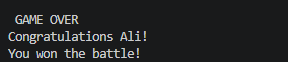

## 🤖 Robot Battle System

## 📌 Project Overview

Robot Battle System is a C++ console-based game that simulates an exciting battle between two robots. The player can choose a robot, perform different actions during the battle, manage energy, and fight against an enemy robot.

The project is developed using Object-Oriented Programming (OOP) concepts and basic C++ programming techniques.

## 📸 Screenshots

<table>
   <tr>
    <td align="center"><b>Robot Selection</b> </td>
    <td align="center"><b>Battle Start</b> </td>
  </tr>
   <tr>
    <td align="center"><b>Battle Gameplay</b> 
    </td>
    <td align="center"><b>Battle Result</b> </td>
  </tr>
</table>

## 🎮 Features

* Enter player's name
* Choose a robot
* Different robot types
* Health and energy system
* Normal attack
* Special ability
* Energy recharge
* Enemy turns and attacks
* Battle status updates
* Win/Lose game result

## 🛠️ Technologies Used
* C++
* Object-Oriented Programming

## 👩‍💻 Author

Laiba Fatima

